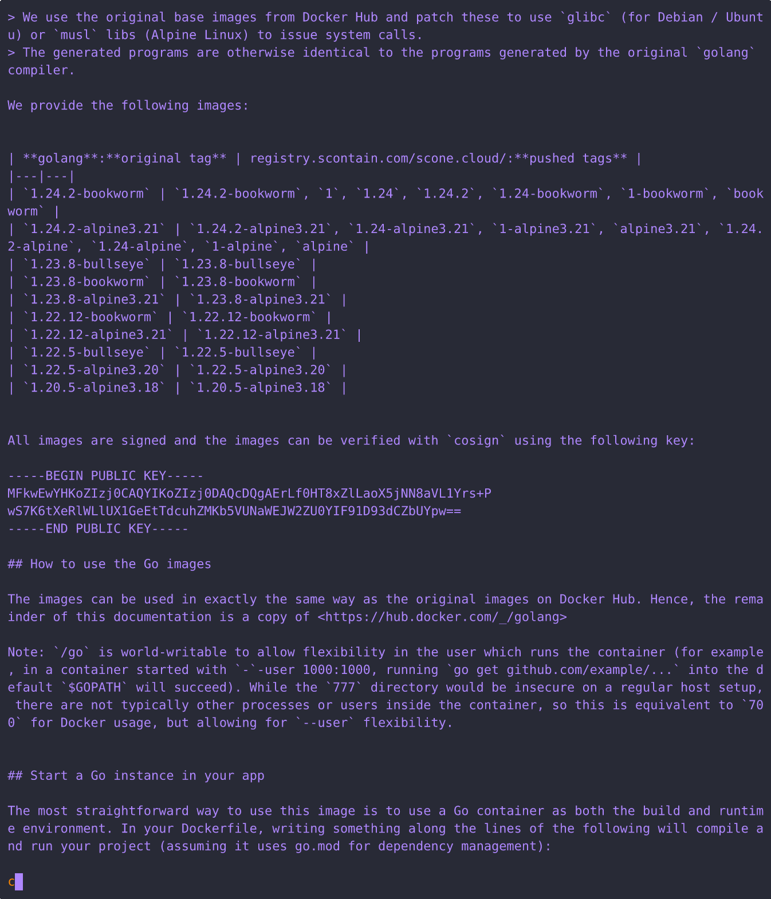

# SCONE Confidential Computing Platform

This repository contains markdown guides that explain how to install the SCONE platform. It also includes a version file:

- [`stable.txt`](stable.txt): the latest stable version of the SCONE platform

## Installation

The SCONE Confidential Computing Platform includes components that run on your local machine (for development) and components that run in a Kubernetes cluster (for development and production). This guide shows how to run the development components in a Kubernetes cluster.

### Local Installation

If you want to install the development components on your local machine or on a development VM, follow these steps.

> **Note**: We currently assume your machine is x86-based. CPU emulation is not sufficient because we require instructions such as `rdrnd` that are not emulated. For this reason, we also show below how to run the development components in a Kubernetes cluster made up of x86 machines.

- [`prerequisite_check.md`](prerequisite_check.md): explains how to install all prerequisites required for `scone` commands. To speed up the process, run `. ./scripts/prerequisite_check.sh`. The leading `.` is required so the current shell's `PATH` is updated.


- [`sconecli.md`](sconecli.md): describes how to install the required SCONE workflow commands (`scone`, `kubectl-scone`, `kubectl-scone-azure`, `scone-td-build`) on your machine or development VM. To speed up the process, run `./scripts/install_sconecli.sh` to install either the latest stable version (default) or another SCONE version.


## Kubernetes Cluster Installation (Development and Production Components)

If you do not have a dedicated x86 development VM, you can run the development components as part of a Kubernetes cluster with x86 nodes:

- [`prerequisite_check.md`](prerequisite_check.md): run `. ./scripts/prerequisite_check.sh` to ensure `kubectl` and `cargo` are installed.


Next, install the SCONE platform and an initial CAS instance in your Kubernetes cluster. These components are required to run confidential applications, so the cluster is expected to run Kubernetes nodes that support confidential computing.

> **Note:** We can provide a `kubectl` plugin to create a confidential Kubernetes cluster on-premises or on common cloud providers. Contact us at info@scontain.com.

- [`scone_operator.md`](scone_operator.md): describes how to install or upgrade the SCONE platform in a Kubernetes cluster. To speed up the process, run `./scripts/reconcile_scone_operator.sh`.


- [`CAS.md`](CAS.md): describes how to create a CAS instance. You can also run `./scripts/install_cas.sh`, which prompts for the CAS name and namespace.


- [`scone_monitoring.md`](scone_monitoring.md): optional installation of Prometheus, Grafana, and SCONE dashboards.


- Inside the container, you can build confidential applications such as our [confidential Java app](https://github.com/scontain/java-args-env-file).

- [`k8s.md`](k8s.md): describes the steps to deploy SCONE commands in a Kubernetes cluster. These steps are also included in `./scripts/k8s_cli.sh`.


## Tutorials

- [scone-td-build](https://github.com/scontain-gmbh/scone-td-build-demos): shows how to transform cloud-native applications into confidential cloud-native applications running on Intel SGX, Intel TDX or AMD SEV-SNP.

- [confidential Java app](https://github.com/scontain/java-args-env-file): shows how to run a cloud-native Java service as a confidential cloud-native Java service on Intel SGX, Intel TDX, or AMD SEV-SNP.

- [golang.md](golang.md): SCONE Go support documentation and workflow.



- [Go support](https://github.com/scontain/golang): provides container images with the latest `Go` versions for building native applications.
- Shows how to build a native `Go` application (`caddy`) into a [`confidential caddy`](https://github.com/scontainug/caddy) application using [`scone-signer`](https://sconedocs.github.io/CAS_cli/#scone-signer).

## SCONE Workshop Container Image

We maintain a prebuilt container image at <registry.scontain.com/workshop/scone> that contains all SCONE development tools.

### Pull Credentials

This container image needs access to `registry.scontain.com`; credentials are stored in `scone-registry.env`.

- If you are already logged in to `registry.scontain.com` with your local Docker instance, run:

```bash
./scripts/extract_scone-registry-env.sh
```

This creates `scone-registry.env`.

- If you are not logged in yet, you can create the file manually:

```bash
tplenv --file scone-registry.env.template --output scone-registry.env --values registy.credentials.yaml --create-values-file --context --force
```

### Run the Workshop Image

Create a container from the image:

```bash
export KUBECONFIG_PATH=${KUBECONFIG:-$HOME/.kube/config}
docker run -it --rm \
    -v /var/run/docker.sock:/var/run/docker.sock \
    -v $KUBECONFIG_PATH:/kubeconfig \
    -v ./scone-registry.env:/scone-registry/scone-registry-env \
    registry.scontain.com/workshop/scone
```

> **Note:** `./scripts/k8s_cli.sh` deploys the workshop image in a Kubernetes cluster. Because Docker is required to build container images, a Docker engine also runs in the Kubernetes cluster.

## Background

### Automatic Script Extraction

Each markdown file is associated with a script that executes the documented steps.

- `scripts/extract-all-scripts.sh`: most scripts in the `scripts` directory are automatically derived from markdown files. If you update markdown content, regenerate scripts by running `scripts/extract-all-scripts.sh`.
- `scripts/extract-bash.sh`: extracts all `bash` and `sh` blocks from a markdown file and stores them in a script file.

Generate updated screencasts by running `make`.

### Building the workshop image

Prepare the override binaries, then build the image with the same SCONE release:

```bash
SCONE_VERSION=6.0.8 ./overwrite.sh
./scripts/build.sh --version 6.0.8
```

`overwrite.sh` builds `scone-td-build` **0.4.0** from pinned revision
`b607bdc7009fc8990c2f083fdf02180f436c5369` and `kubectl-scone` **6.0.5** from
`00044d0bbe70f005398833eb9a5efac394fd93d4`. The plugin uses the boolean
`autoUpdate` schema expected by the 6.0 operator. Its patch version differs from
the **6.0.8** SCONE image/package release. It no longer follows `main`.
The public helpers and Azure plugin are also built. Cargo names the Azure executable
`kubectl-scone_azure`; `overwrite.sh` renames it to `kubectl-scone-azure`, which is
the name kubectl plugin discovery requires. `kubectl-provision` is copied from
`$HOME/.cargo/bin/kubectl-provision` (override that path with
`KUBECTL_PROVISION_BINARY`). Private repository access is required.

Builds use a temporary directory. All binaries must pass validation before they
replace existing overrides; files are copied completely and flushed before atomic
replacement. To select different source revisions, set `SCONE_TD_BUILD_REV` and
`SCONE_KUBECTL_PLUGIN_REV`. Their output must still pass the target version and
interface checks. `SCONE_VERSION` defaults to `stable.txt` for `overwrite.sh`.

To validate the latest `scone-td-build` commit on `main` end to end, run:

```bash
SCONE_VERSION=6.0.8 ./overwrite.sh --validate-latest
```

This builds the candidate in a temporary directory, checks the tooling, then
builds and pushes a revision-specific validation image and runs all demos via
`build.sh --test`. It does not replace `overwrite/bin`; the validation image
remains in the registry under `workshop/scone-validation-<revision>`.
Run it with registry push access and a disposable Kubernetes cluster: the demos
create and deploy application resources. A passing run identifies the exact
revision that can then be installed with `SCONE_TD_BUILD_REV`. Validation prints
that command on success. A later normal build uses the existing `overwrite/bin`,
so install the validated revision before building and publishing it:

```bash
SCONE_VERSION=6.0.8 SCONE_TD_BUILD_REV=<validated-commit> ./overwrite.sh
./scripts/build.sh --version 6.0.8 --push
SCONE_VERSION=6.0.8 ./scripts/k8s_cli.sh
```

`build.sh` normally uses prepared overrides from `overwrite/bin`; it does not
compile them. Before calling Docker it validates the selected override directory,
independently of host `PATH`. The Dockerfile repeats the checks inside the image,
using a named BuildKit context for the selected overrides, and fails on missing or
uncopyable binaries. It uses the requested `SCONE_VERSION` for package installation.
After building, `build.sh` runs the installed tooling check in the completed image
before tagging or pushing it. These tooling checks do not contact Kubernetes;
`--test` and `--validate-latest` deploy and run demos on the current Kubernetes
context.

To check overrides without building:

```bash
SCONE_VERSION=6.0.8 ./scripts/check-scone-tooling.sh --overrides-dir overwrite/bin
```

The build uses the `dind` Docker context at `tcp://172.17.0.1:2375` for building,
checking, tagging and pushing. It requires `$HOME/.kube/config` and
`$HOME/.docker/config.json` as BuildKit secrets. Local credential YAML files are
excluded from the build context by `.dockerignore` and remain on the host.

To build and push the versioned image:

```bash
./scripts/build.sh --version 6.0.8 --push
```

`--push` publishes to `registry.scontain.com/workshop/scone:<SCONE_VERSION>`,
the default image installed by `k8s_cli.sh`. Explicit `CLI_IMAGE`, `CLI_NAMESPACE`,
and `SCONE_VERSION` settings take precedence over saved values when deploying.
The script prints the selected image, waits for rollout, and reports the installed
`scone-td-build` version. Set `K8S_CLI_DEPLOY_ONLY=true` to deploy without opening
an interactive shell; `build.sh --test` uses this mode before starting the demos.

After deployment, `k8s_cli.sh` checks the local `scone-toolbox-k8s` SSH alias. It
asks before adding or correcting the alias. If SSH is not listening on local
port `2222`, it offers to start a background port-forward and verifies that SSH
responds before reporting readiness. It prints the login commands and forwarding
process ID and log path. The helper `scripts/configure-toolbox-ssh.py` validates
effective SSH settings and stages approved updates before atomically replacing
the config.
Deployment-only mode reports SSH instructions without prompting, editing SSH
configuration, or starting forwarding. Restart forwarding after replacing the
toolbox pod; a configured alias alone does not create a tunnel. If your private
key is encrypted, interactive SSH will prompt for its passphrase; you can also
unlock it with `ssh-add` when an SSH agent is running.
Set `TOOLBOX_SSH_CONFIG` to use an alternative SSH configuration file.

Use `--push-to <IMAGE_NAME>` to publish to a different repository; supply the
repository without a tag or digest.
Choose either `--push` or `--push-to`. Without either option, the build remains
local to the `dind` Docker daemon and prints a warning.

To build, push, and run the demos against the current Kubernetes context:

```bash
./scripts/build.sh --version 6.0.8 --push --test
```

`--test` deploys the selected versioned image, then clones or updates
`scone-td-build-demos` and runs its demo suite. When combined with `--push` or
`--push-to`, the image is pushed before deployment. The demos revision is
currently not pinned. Use a disposable cluster with the required SCONE runtime,
CAS, and registry credentials. `--verbose` prints executed commands, and both
`build.sh` and `overwrite.sh` support `--help`.

For prepared overrides outside this checkout, set `SCONE_OVERRIDE_DIR` to the
directory containing `bin/`. `--validate-latest` uses this variable to supply its
temporary candidate binaries to `build.sh`.

The local regression scripts mock external build and deployment commands:

```bash
./tests/workshop-build.test.sh
./tests/overwrite-validate-latest.test.sh
./tests/toolbox-image.test.sh
python3 ./tests/toolbox-ssh.test.py
python3 ./tests/toolbox-port-forward.test.py
```

They check the build workflow and preservation of installed overrides. Run
`--validate-latest` for the actual image build, push, and demo validation.
